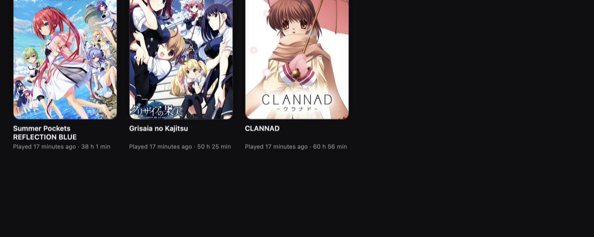
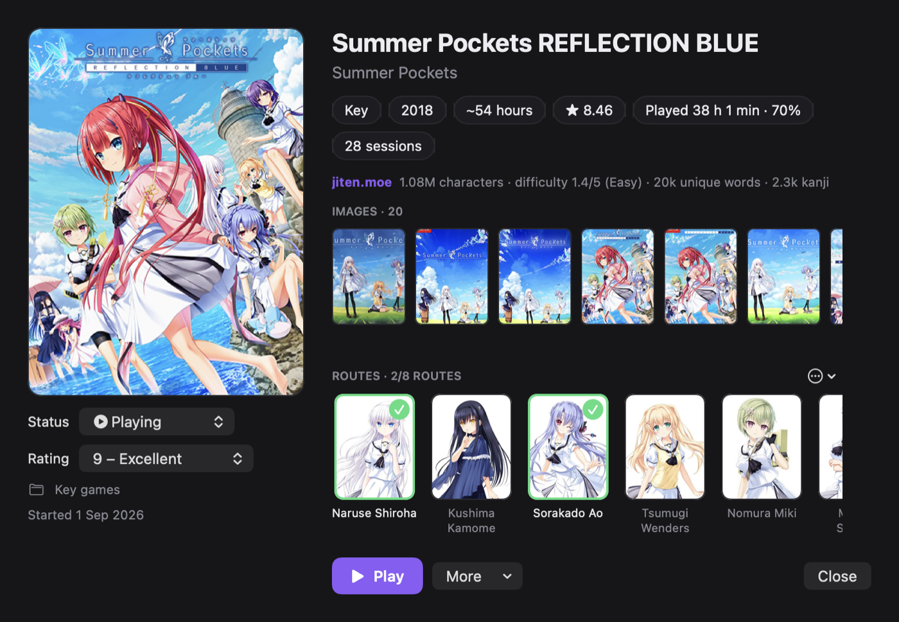
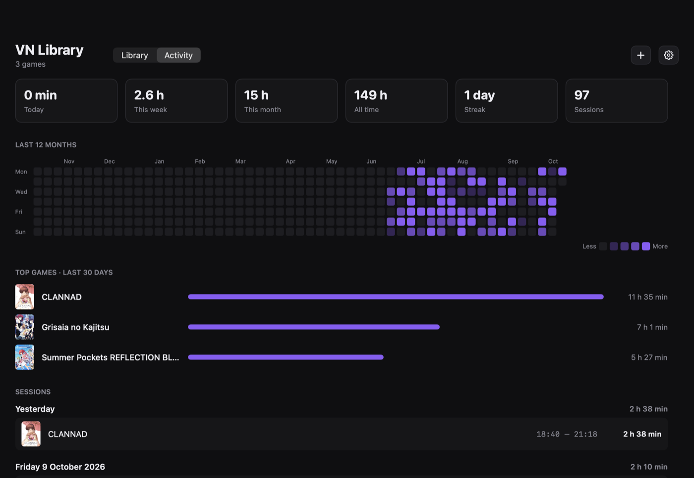
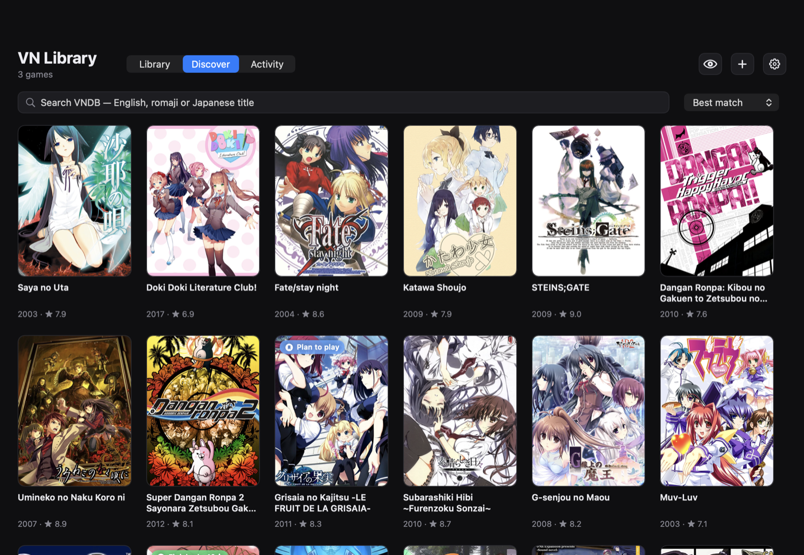
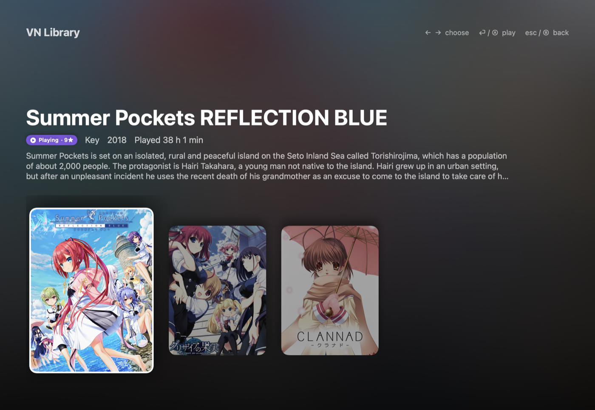

# VN Library

<p align="center">
  
</p>

<p align="center">
  A native macOS library and launcher for visual novels — with covers, tags and info from <a href="https://vndb.org">VNDB</a>.
</p>

<p align="center">
  <a href="https://github.com/bumsar1/VNLibrary/releases/latest">
    
  </a>
  &nbsp;
  
  &nbsp;
  
</p>

<p align="center">
  
</p>

---

## Install

1. Download **VN-Library.dmg** from the [latest release](https://github.com/bumsar1/VNLibrary/releases/latest)
2. Open the DMG and drag **VN Library** into your Applications folder
3. The app isn't notarized, so the first time: right-click it → **Open**

Or build it yourself (needs Xcode):

```bash
./build_app.sh
```

---

## Features

- **KiriKiri games** run natively with KiriKiri Player (krkrsdl2, built in the VN-Ports project): add a raw KiriKiri folder and it's detected and launched with the player.
- **BGI / Ethornell games** run natively with BGI Player (ethornell-rs), bundled like KiriKiri Player.
- **AliceSoft games** (System 3.5–3.9 and System 4, e.g. Rance) run natively with AliceSoft Player (xsystem35 / xsystem4), bundled too.
- **Drag & drop** — drop game folders or Mac apps into the window (or onto the Dock icon)
- **VNDB** — cover, description, developer, release year, length, rating and tags are fetched automatically; pick the right entry yourself with *Fetch from VNDB…** if the guess was wrong
- **Tags** — click a tag on a game's page, or use the **Tags** menu, to filter the library. Sexual-content tags are shown in pink and can be hidden in Settings; spoiler tags are never shown
- **Blur cover** — per game, from the right-click menu. Images VNDB flags as suggestive are blurred in Discover and galleries with a *Show* button (can be turned off in Settings). Library covers VNDB flags as suggestive are blurred automatically; their pixels are blurred, so nothing shows through
- **Activity tracker** — every session is logged with its day, start and end time and length. The Activity tab shows today / week / month / all-time totals, your streak, a year-long heatmap of the days you played (click a day to see its sessions), your top games and the full session log. Idle time (no input for 10 minutes) doesn't count
- **Progress** — play time against VNDB's estimated length on each game's page
- **Discover** — search and browse all of VNDB (best match, highest rated, most popular, newest), with VNDB's filters: release language (defaults to Japanese), original language, platform, length, rating, release date, finished only, tags and developer. Click a developer on any game page to see everything they made. Filters are remembered. 18+ VNs get a red border. Add anything to your library as *Plan to play*; when you later drop in its game folder, it's linked to that entry automatically
- **Image gallery** — every screenshot and package scan VNDB has for a game, on its page and in Discover. Click for a large view, step through with the arrow keys, and use any image as the cover
- **jiten.moe** — length in characters, difficulty, unique words and kanji for each VN, and with a jiten.moe API key how much of its vocabulary you already know
- **Japanese titles** — show VNDB's original titles (e.g. グリザイアの果実) instead of romaji
- **Routes** — the heroines from VNDB as a checklist with portraits; tick off cleared routes, add your own (e.g. a true ending). Cards show "2/8 routes"
- **Permissions** — couch mode needs **Accessibility** (System Settings → Privacy & Security) to put games in full screen. Grant it, and Meikipop's permissions (see its guide), before you play
- **Companion apps** — open apps like Meikipop alongside every game, or a single one; they close again when the game quits. From couch mode, Meikipop is told which game was started and picks its window by itself, even in full screen
- **Weekly goal and Year in Review** — a goal ring on the Activity tab, and a yearly summary: hours, days played, longest streak, best day, months, most played and finished games
- **Try with Whisky / CrossOver** — run a game's .exe through one of your Wine bottles (with a Japanese locale) to see if it plays well, and keep the setup if it does
- **siglus_engine updates** — checks GitHub for a newer siglus_rs and pulls + rebuilds it with one click
- **Engine detection** — recognises SiglusEngine, RealLive/AVG32, KiriKiri, Ren'Py, NScripter, TyranoScript, RPG Maker, Unity and more, and says what runs each natively on a Mac. Key's older RealLive / AVG32 games run with siglus_rs's `game_launcher_run` (built from Settings)
- **Save backups** — the save folder is copied before every session when it changed (newest 15 kept), with one-click restore
- **Watched folder** — new game folders that appear there are added automatically
- **Disk usage** — size of each game, sort by size, and *Move Game Files to Trash* that keeps the game (status, notes, play time) as Not installed
- **Easiest for you** — jiten.moe's VNs sorted by how much of the vocabulary you know (with an API key) or by difficulty, in Discover and couch mode
- **Characters read** — counts the Japanese text you actually read, from what [Meikipop](https://github.com/bumsar1/Meikipop-Mac) recognises on screen while you play. Every line counts once per game: text that types itself out counts when finished, re-reads and the backlog don't count again, and OCR slips of a character or two are caught. Shown per game (with % of the whole text from jiten.moe), per session (with characters per hour), and per week. Click a session's character count to read back the text it counted, search it, and take lines off the count: *Delete* (it can count again if it shows up later) or *Blacklist* (that exact sentence never counts again in this game — for menus and UI text; undo under Blacklist). A built-in, editable list of common VN menu words (セーブ, ロード, オート, SAVE, LOAD …) never counts in any game, nor do lines without Japanese in them
- **Where you left off** — the last lines you read, on the game page and in couch mode
- **Reading speed** — characters per hour week by week and by time of day, plus an optional daily reading goal in characters
- **Kanji you've met** — every kanji in the text you've read, counted, and checked against your WaniKani progress (taught, passed, not taught yet, not in WaniKani)
- **Finished?** — when all routes are ticked or ~90% of the text is read, VN Library offers to mark the game finished
- **Status, rating and notes** — Playing / Finished / On hold / Dropped / Plan to play, your own 1–10 rating and notes per game. Starting a game marks it as Playing
- **VNDB list sync** — connect your VNDB account (API token, kept in the keychain) and status, rating, notes and dates are sent to your list as you change them; import your existing list in one click
- **Collections** — your own groups, e.g. "Key games"
- **Ready to play / Not installed** — the library is split into games you can launch right now and ones without a folder yet (added from Discover, or moved)
- **Filter** — by status, collection, tag or installed, with removable filter chips; sort by last played, name, date added or your rating
- **Random pick** — the dice button (⌘R) picks something from your Plan to play list
- **Couch mode** — full-screen, console-style browsing (⌘⇧F) with arrow keys or a game controller: rows for Continue playing, Ready to play and Not installed, plus VNDB categories (new releases, coming soon, highest rated, most popular, hidden gems, and picks based on your favourite tags) that you can add to Plan to play from the sofa. Selecting a title opens its game page — description, tags, jiten.moe difficulty, screenshots — with buttons for Play, status, rating or Add to Plan to Play. Search with an on-screen keyboard (ABC, hiragana, katakana). Games started here open in full screen. A VNDB screenshot of the selected game fills the background, with soft UI sounds
- **Discreet mode** — one click (⌘⇧D) blurs every cover and hides adult games and sexual tags
- **Search** — matches names, VNDB titles (incl. Japanese), developers and tags

<p align="center">
  
</p>

<p align="center">
  
</p>

<p align="center">
  
</p>

<p align="center">
  
</p>

## Launching games

| Kind | How it starts |
|---|---|
| **Siglus** (Key games: Summer Pockets, Clannad, …) | Detected automatically (`Scene.pck` + `Gameexe.dat`). Runs [`siglus_engine`](https://github.com/xmoezzz/siglus_rs) built from source — it scales the game to fill the window, which the prebuilt Siglus.app doesn't. Set its path under Settings. |
| **Mac app** | Any `.app` — a Ren'Py port, a CrossOver/Whisky shortcut, … |
| **Custom command** | Run in `zsh` with the game folder as working directory; `$GAME_DIR` is its path. E.g. `open -a Whisky "$GAME_DIR/game.exe"` |

### Building siglus_engine

```bash
git clone --depth 1 https://github.com/xmoezzz/siglus_rs ~/siglus_rs
cd ~/siglus_rs && cargo build --release -p siglus_scene_vm --bin siglus_engine
```

The default path in Settings is `~/siglus_rs/target/release/siglus_engine`.

---

Library data lives in `~/Library/Application Support/VN Library/`. Game data from [VNDB](https://vndb.org) (ODbL).
